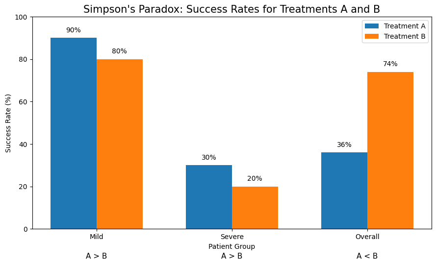

## Introduction: Why an Overall Average Can Change a Decision

Suppose a hospital must choose which of two treatments to recommend. Treatment B has an overall success rate of 74%, compared with only 36% for Treatment A. Choosing B seems straightforward. But what if Treatment A has a higher success rate among both mild and severe patients?

This question matters because averages often guide real decisions. Hospitals compare treatments, companies evaluate sales teams, and policymakers assess employment programs. Yet the people served by each treatment, team, or program may differ. A program serving people who face greater barriers could have a lower overall success rate even if its observed results are stronger within comparable groups. Evaluating performance using only the overall rate could therefore reward a favorable case mix.

This post asks: **How can one treatment have a higher success rate within every patient group, yet a lower success rate overall?** A simple hypothetical example illustrates Simpson's Paradox and shows why we need to understand who is included in an average before using it to make a decision.

## A Simple Example: Two Treatments, Different Patients

Simpson's Paradox occurs when the direction of an association within separate groups reverses when those groups are combined.

Suppose patients are classified as having mild or severe conditions **before treatment**. @tbl-treatment-outcomes presents the example. **All patient counts are hypothetical and constructed for this explanation; they do not come from an actual medical study.** A success rate is the number of successful outcomes divided by the number of patients receiving that treatment in the relevant group.

| Patient severity | A: successful outcomes / patients | A success rate | B: successful outcomes / patients | B success rate |
|:-----------------|---------------------------------:|---------------:|---------------------------------:|---------------:|
| Mild | 90 / 100 | 90% | 720 / 900 | 80% |
| Severe | 270 / 900 | 30% | 20 / 100 | 20% |
| **Overall** | **360 / 1,000** | **36%** | **740 / 1,000** | **74%** |

: Hypothetical patient counts and observed success rates by treatment and severity. Source: constructed illustrative example; percentages calculated from the displayed counts. {#tbl-treatment-outcomes}

Within each severity group, Treatment A has the higher observed success rate:

- **Mild cases:** 90% for A versus 80% for B.
- **Severe cases:** 30% for A versus 20% for B.

In both groups, A's advantage is **10 percentage points**. However, combining the patients produces the opposite ranking.

For Treatment A, the overall success rate is

$$
p_A = \frac{90 + 270}{100 + 900}
= \frac{360}{1{,}000} = 36\%.
$$

For Treatment B, it is

$$
p_B = \frac{720 + 20}{900 + 100}
= \frac{740}{1{,}000} = 74\%.
$$

Thus, A has the higher success rate in both severity groups, while B has the higher overall success rate. Both calculations are correct. The reversal occurs because the overall rates summarize populations with different compositions.

## Why Does the Comparison Reverse?

The key difference is **who receives each treatment**. Of A's patients, 90% are severe cases. Of B's patients, only 10% are severe cases. Severe patients have lower success rates under either treatment, so treating a larger proportion of severe patients lowers the overall rate.

An overall success rate is a weighted average:

$$
p_T = w_{T,m}p_{T,m} + w_{T,s}p_{T,s},
\qquad w_{T,m}+w_{T,s}=1.
$$

Here, $T$ identifies the treatment, $m$ denotes mild cases, and $s$ denotes severe cases. The term $p_{T,g}$ is the success rate for treatment $T$ in group $g$, while $w_{T,g}$ is that group's share of the treatment's patients.

For Treatment A,

$$
p_A = 0.10(0.90) + 0.90(0.30) = 0.36.
$$

For Treatment B,

$$
p_B = 0.90(0.80) + 0.10(0.20) = 0.74.
$$

B's overall rate places much more weight on mild cases, where success is more common. A's rate places much more weight on severe cases, where success is less common. These different weights are large enough to reverse the observed within-group ranking.

The paradox does not require a mistake in the arithmetic. **The overall comparison combines differences in success rates with differences in patient composition.** Reporting success rates alongside the underlying patient counts makes this mechanism visible.

## Visualizing the Paradox

@fig-success-rates compares the observed success rates for mild cases, severe cases, and all patients combined.

{#fig-success-rates width=85%}

The figure makes the reversal visible: A leads B by 10 percentage points among both mild and severe patients, yet B leads A by 38 percentage points overall. The overall bars summarize different patient mixes, so they do not represent a comparison holding severity composition fixed. Read alongside the patient counts in @tbl-treatment-outcomes, the figure shows both the reversal and why it occurs.

## A More Comparable Summary: Use the Same Patient Mix

We can examine the role of patient composition by applying the same weights to both treatments. This calculation is called standardization.

Suppose the population of interest consists of 50% mild and 50% severe patients. Using that common patient mix gives

$$
p_A^{\text{standardized}}
= 0.50(0.90) + 0.50(0.30) = 60\%,
$$

and

$$
p_B^{\text{standardized}}
= 0.50(0.80) + 0.50(0.20) = 50\%.
$$

| Comparison | Treatment A | Treatment B | A minus B |
|:-----------|------------:|------------:|----------:|
| Observed overall rate: different patient mixes | 36% | 74% | −38 percentage points |
| Standardized rate: 50% mild, 50% severe for both | 60% | 50% | +10 percentage points |

: Observed and standardized success rates in the hypothetical example. Standardized rates apply a common patient composition to the within-group rates. {#tbl-standardized-rates}

With the same patient mix, A has the higher standardized success rate. These are calculated summaries, not additional observed outcomes.

The equal weights are illustrative. An actual analysis should choose weights that represent the population relevant to the decision. In this particular example, however, A retains its 10-percentage-point advantage under **any common weighting** of the two groups. If $w$ is the common share of mild cases, then

$$
p_A^{\text{standardized}}-p_B^{\text{standardized}}
=w(0.90-0.80)+(1-w)(0.30-0.20)
=0.10.
$$

This result follows because A's observed advantage is exactly 10 percentage points in each group. It helps explain why the original overall ranking reflects the unequal patient mixes so strongly.

## What Do These Results Tell Us?

The aggregate and subgroup comparisons answer different questions.

The **overall rates** describe outcomes among the patients who actually received each treatment. They correctly report that 74% of B's patients succeeded, compared with 36% of A's patients. These figures are useful for describing the observed patient populations.

The **subgroup rates** compare outcomes among patients in the same broad severity category. The **standardized rates** summarize those comparisons using a common patient composition. They are more informative when the aim is to compare observed success rates while holding the severity mix fixed.

However, these comparisons do not establish that A causes better outcomes. Even within a severity category, patients receiving A and B might differ in age, other health conditions, or access to care. A causal conclusion would require an appropriate research design and attention to those differences. Standardizing for severity alone does not solve every comparability problem.

Nor should we automatically divide every dataset into more groups. The useful grouping depends on the question and how the variables relate to treatment and outcomes. In this example, severity is measured before treatment and is relevant to the outcome comparison.

## Conclusion

The same data can support different descriptive comparisons without any arithmetic contradiction. Treatment A has a higher observed success rate within both severity groups, but Treatment B has a higher overall rate because its patients are predominantly mild cases. Applying the same patient mix gives standardized rates of 60% for A and 50% for B.

The practical implication extends beyond this example. A hospital, business, or public program serving more difficult cases can look worse in the aggregate even when its observed results are stronger within comparable groups. An overall ranking alone may therefore be a poor basis for evaluating performance.

**Before acting on an average, ask who is included, whether the groups have different compositions, and which comparison answers the decision at hand.** Understanding the population behind a statistic is as important as calculating the statistic correctly.
