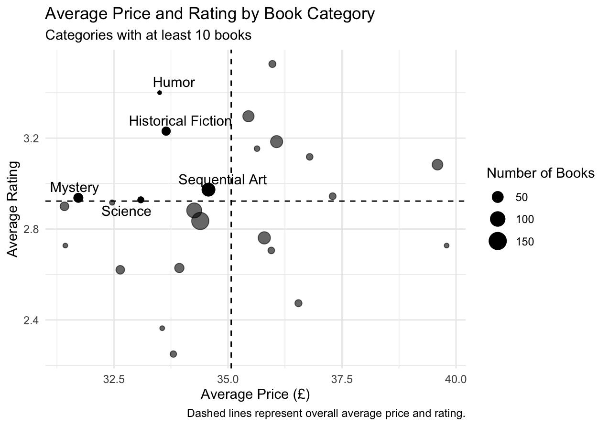

## Finding a Good Read Without Overspending

When choosing a book, price and reader ratings are often two useful pieces of information to consider. A highly rated book may seem appealing, but is it worth the price? On the other hand, the cheapest option may not necessarily provide the best reading experience.

This led me to a simple question:

> **Which book categories offer relatively highly rated books at lower prices?**

Here, a **category** means a shelf label used by the website to group books, such as Humor, Historical Fiction, Mystery, or Science. I compare these groups of books rather than individual titles. Sequential Art, another category in the results, refers to works that tell stories through sequences of images, such as comics and graphic novels.

To explore this question, I used web scraping to collect book information and compared average prices and displayed star ratings across categories. The goal is to create a starting shortlist for browsing, not to establish which genre is objectively better or which book every reader should buy.

## Collecting the Data

For this analysis, I scraped data from [Books to Scrape](https://books.toscrape.com/), a website specifically designed for practicing web scraping.

Using the `rvest` package in R, I collected four pieces of information for each book:

- title
- category
- price
- star rating

Because the books are spread across multiple category pages, the scraping process also followed pagination links until all available books in each category were collected. I included short pauses between requests to avoid sending requests to the website too frequently.

After scraping the data, I converted prices from text into numeric values and transformed the star-rating labels into a numeric scale from 1 to 5.

## Comparing Book Categories

Since my research question focuses on categories rather than individual books, I summarized the data at the category level. For example, Humor’s average price is the mean price of the books listed under Humor, and its average rating is the mean of those books’ displayed star ratings. It is not an average calculated from individual reader reviews, which I did not collect.

For each category, I calculated:

- the number of books
- average price
- median price
- average rating

One challenge was that category sizes varied substantially. Some categories contained only one or a few books, while the median category contained about 10 books. An average based on only one book could give a misleading impression of an entire category.

For the main comparison, I therefore focused on categories containing **at least 10 books**. This left 25 categories for analysis. This cutoff reduces reliance on very small groups, but it does not eliminate selection bias or establish that differences between categories are statistically meaningful.

## What Counts as "Good Value"?

Rather than creating an arbitrary score such as rating divided by price, I used two simple benchmarks: the overall average book price and the overall average book rating.

I classified a category as meeting the **good-value criteria** when:

1. its average price was below the overall average book price, and
2. its average rating was above the overall average book rating.

This definition makes the tradeoff easy to interpret: I am looking for categories that are relatively less expensive while having relatively higher displayed ratings. “Good value” is therefore a descriptive screening rule within this dataset, not a measure of objective quality or a guarantee of reader satisfaction.

## Price vs. Rating

The figure below compares average price and average rating across the 25 categories included in the analysis.

Each point represents one book category, and the size of the point reflects the number of books in that category. The vertical dashed line represents the overall average price, while the horizontal dashed line represents the overall average rating.

The area in the **upper-left** of the figure is especially interesting. Categories in this region have both lower-than-average prices and higher-than-average ratings, meaning they satisfy both of my good-value criteria.

## Which Categories Stand Out?

Five categories met both criteria:

| Category | Number of Books | Average Price (£) | Average Rating |
|---|---:|---:|---:|
| Humor | 10 | 33.5 | 3.40 |
| Historical Fiction | 26 | 33.6 | 3.23 |
| Sequential Art | 75 | 34.6 | 2.97 |
| Mystery | 32 | 31.7 | 2.94 |
| Science | 14 | 33.1 | 2.93 |

These five categories offer different combinations of price and displayed ratings within this dataset. Their ratings describe the books listed; they do not establish how the same reader would rate books across genres.

**Humor** has the highest average rating among the five categories, at 3.40 stars, while still maintaining a below-average price.

**Historical Fiction** also combines a relatively strong average rating of 3.23 with a below-average price. Its average covers 26 books, compared with 10 in Humor. This is a broader set of listed titles, although a larger book count does not resolve differences in who reads or rates each category.

**Mystery**, meanwhile, has the lowest average price among the five categories at approximately £31.70. For readers who place greater emphasis on price, it therefore represents a particularly affordable option among the categories meeting both criteria.

Sequential Art and Science also fall within the good-value region, although their average ratings are closer to the overall rating benchmark.

## What Should a Budget-Conscious Reader Do?

**Use these categories to narrow a search within genres you already enjoy, then compare individual books before buying.** Category averages help identify where to browse; they do not show that every book in a category is inexpensive or highly rated.

- **If price matters most and you enjoy mysteries, start with Mystery.** At £31.70, it has the lowest average price among the five qualifying categories. Compare actual title prices with your own budget rather than assuming every mystery costs about this amount.
- **If displayed ratings matter most and you enjoy humor, browse Humor first.** Its 3.40-star average is the highest among the five. Treat this as a browsing signal, since readers who choose humor may differ from readers of other genres.
- **If you enjoy historical fiction, use Historical Fiction as another starting point.** It combines a £33.60 average price with a 3.23-star average across 26 books. The larger book count gives you more listed titles to explore, not proof of higher quality.

For a concrete purchasing workflow, choose a genre you like, set a maximum price, and inspect individual titles that fit that budget. Read a synopsis or sample and, in a real bookstore, check review content and review counts where available. Those additional checks are recommendations for a purchase decision; they were not part of this scraped dataset.

Sequential Art and Science remain possible browsing options, but their ratings are close to the benchmark. Small changes in the data or benchmark could change whether they qualify, so their inclusion should not be treated as a strong ranking.

## Limitations

**The main interpretive limitation is reader self-selection.** Readers choose genres based on their interests, and those who submit ratings may also differ from those who do not. For example, people who enjoy humor may be especially likely to choose humor books and give them favorable reviews. Humor’s higher average rating could therefore reflect the preferences or rating habits of its audience rather than higher underlying book quality. The data do not show how the same group of readers would evaluate books across all categories.

I collected book-level displayed ratings, not reviewer identities, review counts, or individual reviews. I therefore cannot test or adjust for this selection mechanism. It is a plausible explanation for cross-category differences, not a finding demonstrated by this analysis. The comparison is descriptive: it cannot show that choosing Humor will cause a reader to enjoy a book more.

Books to Scrape is also a practice website rather than a live bookstore. Its displayed ratings should not be assumed to represent verified real-reader evaluations. The reader-selection issue matters when applying this approach to real review data; this practice dataset cannot establish whether that mechanism generated its ratings. The results illustrate a screening method rather than provide current recommendations for the real book market.

Finally, averages hide variation within categories, and categories contain different numbers and mixes of books. The minimum of 10 books limits the smallest groups but does not make the categories directly comparable. I have not established statistical significance or tested whether the shortlist remains the same under alternative cutoffs. Small rating differences, particularly near the benchmark, should be interpreted cautiously.

## Conclusion

Five categories meet the chosen below-average-price and above-average-rating criteria: **Humor, Historical Fiction, Sequential Art, Mystery, and Science**. Among these, Humor has the highest average displayed rating, while Mystery has the lowest average price.

The practical takeaway is to **use the shortlist as a starting point within your existing reading preferences, then evaluate individual books against your budget and interests**. Higher ratings across genres may reflect different audiences rather than better books. Combining price and ratings can make browsing more focused, but it cannot replace a reader’s own judgment.
