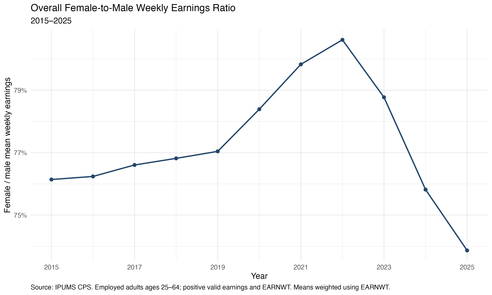
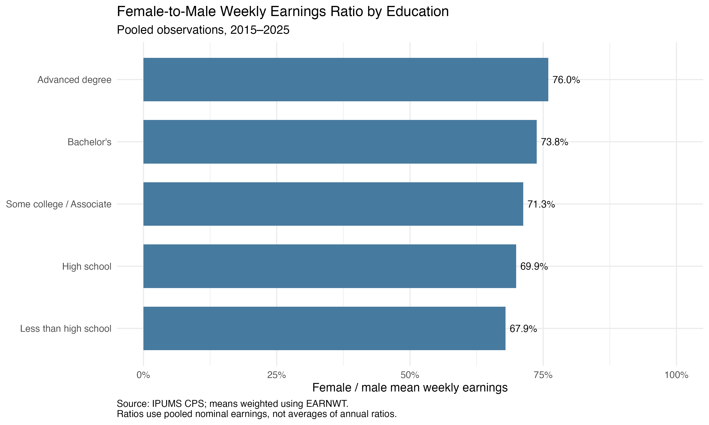
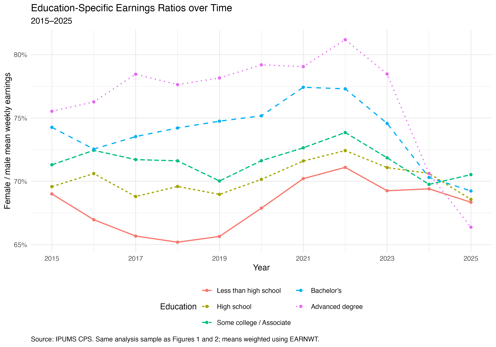
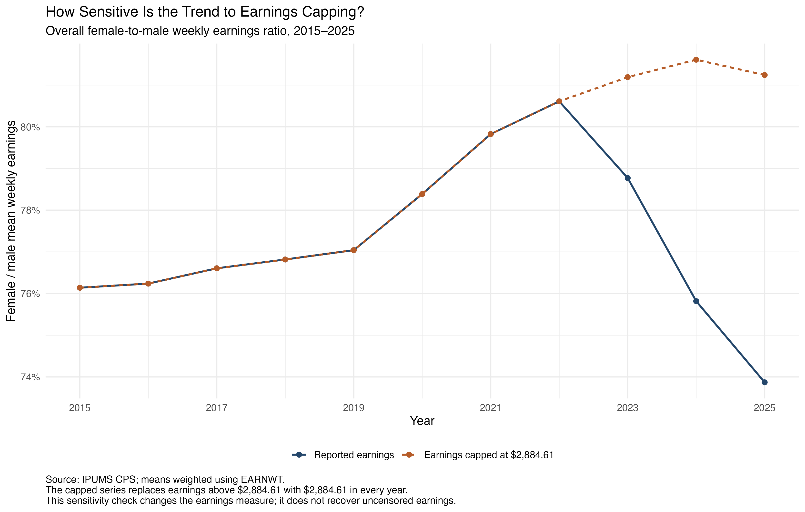

## Introduction

The gender earnings gap is often summarized by a single number. However, an overall average can conceal differences across workers with different educational backgrounds. It can also reflect differences in the education composition of male and female workers.

This motivates my research question:

> How does the gender gap in weekly earnings vary across education levels in the United States?

Using IPUMS Current Population Survey (CPS) microdata from 2015 through 2025, I examine the overall female-to-male weekly earnings ratio, differences across education groups, and changes within those groups over time.

The analysis also examines two issues that matter for interpreting the figures: why the overall ratio can exceed education-specific ratios, and how the treatment of high earnings affects the apparent trend after 2022.

## Data and Methods

The data come from [IPUMS CPS](https://cps.ipums.org/cps/). I read the downloaded compressed CSV extract directly into R using `readr::read_csv()` and generate the figures and tables programmatically.

The analysis uses the following variables:

| Variable | Purpose |
|---|---|
| `YEAR` | Survey year |
| `AGE` | Respondent age |
| `SEX` | Male and female categories recorded in CPS |
| `EDUC` | Educational attainment |
| `EMPSTAT` | Employment status |
| `EARNWEEK2` | Rounded usual weekly earnings |
| `EARNWT` | Earnings sampling weight |

The sample includes employed respondents ages 25–64 in the available observations from 2015–2025, with positive earnings weights and valid positive weekly earnings. Because the earnings questions cover a restricted group of wage and salary workers, the results should not be interpreted as describing all adults or all employed people.

I classify educational attainment into five groups:

- Less than high school
- High school
- Some college / Associate
- Bachelor's
- Advanced degree

All three main figures use the same analysis sample. Every education code appearing in this sample was successfully classified.

For each relevant group, I calculate weighted mean weekly earnings:

$$
\bar y_{s,e,t}
=
\frac{
\sum_{i \in (s,e,t)} w_i y_i
}{
\sum_{i \in (s,e,t)} w_i
},
$$

where \(y_i\) is weekly earnings, \(w_i\) is `EARNWT`, \(s\) indicates sex, \(e\) indicates education, and \(t\) indicates year.

I then calculate the female-to-male earnings ratio:

$$
R_{e,t}
=
\frac{\bar y_{F,e,t}}{\bar y_{M,e,t}}.
$$

A ratio of 0.75 means that women's weighted mean weekly earnings are 75% of men's within the relevant group. This is a ratio of group means, not an average of individual earnings ratios.

IPUMS recommends using `EARNWT` with `EARNWEEK2`. Further information is available in the [earnings variable documentation](https://cps.ipums.org/cps-action/variables/EARNWEEK2).

## The Overall Earnings Ratio over Time

Figure 1 shows that the overall female-to-male weekly earnings ratio increased from approximately **76.1% in 2015** to **80.6% in 2022**. Using earnings as recorded in the extract, the ratio subsequently declined to **78.8% in 2023** and **73.9% in 2025**.

Taken alone, this figure suggests that the earlier improvement reversed after 2022. However, interpreting that decline requires caution because the treatment of high earnings changed during this period. I return to this issue in the sensitivity analysis.

The overall ratio also combines workers with different educational backgrounds. It therefore provides a useful summary, but it does not describe the gap within every education group.

## Differences Across Education Groups

Figure 2 compares education groups using observations pooled across the full period.

| Education group | Female-to-male earnings ratio |
|---|---:|
| Less than high school | 67.9% |
| High school | 69.9% |
| Some college / Associate | 71.3% |
| Bachelor's | 73.8% |
| Advanced degree | 76.0% |

In these pooled estimates, higher education groups have higher female-to-male weekly earnings ratios. Nevertheless, women's mean earnings remain below men's in every group.

These results are descriptive. They do not establish that obtaining more education causes the gender earnings gap to narrow. Workers with different education levels also differ in occupation, industry, hours worked, experience, and other characteristics.

The figure uses pooled nominal earnings. Its ratios are neither estimates for 2023 alone nor simple averages of the annual ratios. They also reflect how observations and earnings are distributed across years.

## Education-Specific Trends and the Role of Composition

Figure 3 separates the annual trends by education. Ratios vary both across groups and within groups over time.

For example, in 2023, the ratios were approximately:

| Education group | 2023 earnings ratio |
|---|---:|
| Less than high school | 69.3% |
| High school | 71.1% |
| Some college / Associate | 71.9% |
| Bachelor's | 74.6% |
| Advanced degree | 78.5% |
| Overall | 78.8% |

Why can the overall ratio exceed all five education-specific ratios?

The reason is that men and women have different education distributions. In the 2023 analysis sample, **49.4% of women had a bachelor's or advanced degree**, compared with **41.7% of men**, using earnings weights.

The overall ratio is:

$$
R_t
=
\frac{
\sum_e s_{F,e,t}\bar y_{F,e,t}
}{
\sum_e s_{M,e,t}\bar y_{M,e,t}
},
$$

where \(s_{F,e,t}\) and \(s_{M,e,t}\) are education shares calculated separately for women and men.

Because these shares differ, the overall ratio is not a simple average of the education-specific ratios. Women's greater representation in higher-earning education groups can raise the overall ratio relative to the within-group comparisons.

As a coding check, I reconstructed the overall male and female means from the education-group means and their corresponding education shares. The reconstructed means matched the directly calculated overall means within numerical tolerance.

Thus, the overall and education-specific results are internally consistent in this calculation. They answer different questions: the overall ratio includes education composition differences, while the group ratios compare workers within the same broad education category.

## Sensitivity to the Treatment of High Earnings

The decline after 2022 is especially pronounced for workers with advanced degrees. However, mean earnings are sensitive to high values, and the earnings measurement rules changed during this period.

According to the [IPUMS documentation](https://cps.ipums.org/cps-action/variables/EARNWEEK2), dynamic topcoding began to be phased in during April 2023 and applied to both outgoing rotation groups from April 2024 onward.

In my sample, maximum recorded weekly earnings increased from approximately $2,885 in 2022 to more than $10,000 in 2023. This raises a comparability concern for trends based on mean earnings.

To examine sensitivity, I repeat the overall calculation after applying a common nominal cap:

$$
y_i^{cap} = \min(y_i, 2884.61).
$$

I use the same sample and earnings weights, changing only the earnings measure.

The two series are almost identical through 2022, but diverge afterward.

| Year | Reported earnings ratio | Common-cap earnings ratio |
|---|---:|---:|
| 2022 | 80.6% | 80.6% |
| 2023 | 78.8% | 81.2% |
| 2024 | 75.8% | 81.6% |
| 2025 | 73.9% | 81.2% |

Under the common cap, the sharp post-2022 decline disappears. In 2025, the capped ratio is approximately **7.37 percentage points higher** than the ratio using reported earnings.

The main implication is that the apparent recent decline is highly sensitive to the treatment of upper-tail earnings. It should not be interpreted directly as evidence that the underlying gender earnings gap widened by the amount shown in Figure 1.

This comparison does not prove that coding changes caused the entire divergence. Capping also removes potentially meaningful earnings differences above the threshold. The capped series measures a different outcome; it does not recover uncensored earnings or fully harmonize all measurement changes.

## Limitations

First, this analysis is descriptive rather than causal. It does not isolate the effects of education or measure discrimination.

Second, weekly earnings reflect both pay rates and hours worked. These results therefore describe weekly earnings gaps rather than hourly wage gaps.

Third, education groups remain broad. Workers within the same group may differ in occupation, industry, experience, and other characteristics.

Fourth, the analysis uses available observations in the extract. Annual comparisons may be affected by differences in month coverage, which should be checked against the extract documentation.

Fifth, the pooled education comparison combines nominal earnings across years. Within-year ratios are unchanged by applying a common inflation adjustment to both sexes, but the pooled comparison is not a constant-dollar comparison.

Finally, the common-cap check uses a fixed nominal threshold. As earnings rise, it can affect a larger share of workers. It is a sensitivity analysis rather than a complete solution to cross-year comparability.

## Conclusion

The gender gap in weekly earnings varies across education groups. In the pooled 2015–2025 sample, female-to-male earnings ratios range from approximately **67.9% among workers with less than a high school education** to **76.0% among workers with advanced degrees**.

The overall ratio must also be interpreted in light of education composition. Women and men have different education distributions, so the overall ratio can exceed the ratios within individual education groups.

Finally, the apparent decline after 2022 is highly sensitive to the treatment of high earnings. Applying a common cap removes the sharp decline in the overall series.

Together, the figures show why a single earnings-gap statistic is insufficient: interpretation requires attention to group composition, the earnings measure, and changes in how the data are recorded.