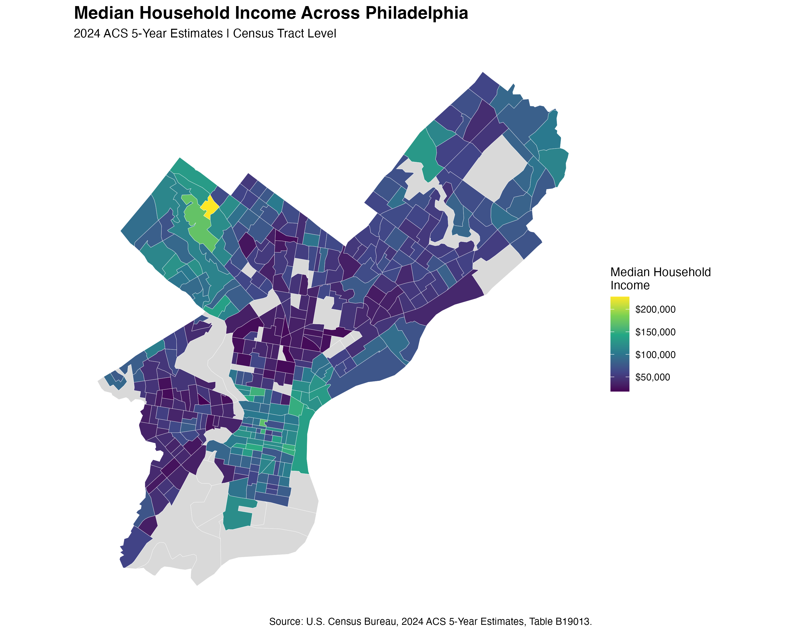
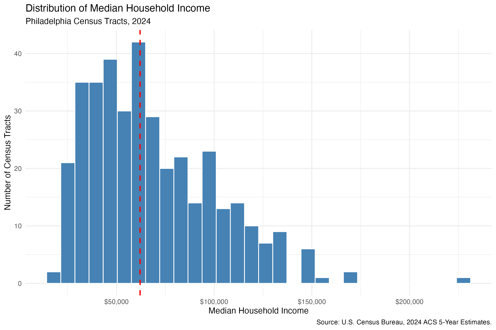

## Introduction

A single income statistic cannot tell us how economic resources are distributed across a city. Two cities could have the same citywide median household income but very different differences between neighborhoods. Even the same set of neighborhood income values could be arranged differently: lower-income areas might be dispersed or located next to one another. Understanding both the size and the geography of these differences is therefore important for describing urban economic conditions.

This post asks: **How much does median household income vary across Philadelphia census tracts, and what does its spatial arrangement add to our understanding of those differences?** I use a choropleth map to examine location and a histogram to examine the distribution of tract median incomes. The analysis concerns **income disparities between census tracts**, rather than inequality among all individual households or inequality within each tract.

## Data and Methods

The analysis uses the U.S. Census Bureau's **2024 American Community Survey (ACS) 5-Year Estimates**, Table **B19013**. These estimates pool survey responses collected during **2020–2024**; they are period estimates rather than a snapshot of 2024 alone. The variable is **median household income in the past 12 months**, expressed in **2024 inflation-adjusted dollars**. Census tracts are statistical geographic units and do not necessarily coincide with commonly recognized neighborhood boundaries.

The ACS table was downloaded from [data.census.gov](https://data.census.gov/table/ACSDT5Y2024.B19013), cleaned in R, and joined to 2024 census tract cartographic boundaries using **GEOID**. Boundaries were retrieved with `tigris`, and spatial processing and visualization used `sf` and `ggplot2`. The map uses a continuous income scale, with gray indicating tracts without a valid income value in the analysis dataset. Gray does not mean zero income.

The geographic dataset contains **408 tracts**, of which **375** have valid positive income estimates and **33**, approximately **8.1%**, lack valid values in the cleaned dataset. The statistics and histogram below describe the 375 valid tracts. Each tract receives equal weight, regardless of its number of households or geographic area.

| Statistic across valid census tracts | Value |
|:------------------------------------|------:|
| Number of tracts | 375 |
| Mean of tract median incomes | $68,707 |
| Median of tract median incomes | $62,083 |
| Minimum tract median income | $17,875 |
| Maximum tract median income | $227,656 |
| Standard deviation of tract median incomes | $32,658 |

These are summaries of **tract medians**. In particular, $62,083 is the middle tract's income estimate when the valid tracts are ranked; it is not an estimate of Philadelphia's citywide household income median. Averaging tract medians also does not recover the mean income of all Philadelphia households.

## Where Are Higher- and Lower-Income Tracts Located?

{#fig-income-map fig-alt="Choropleth map of Philadelphia census tracts showing higher income values in parts of the northwest and an additional higher-income area toward the eastern side of the southern portion of the city, with many lower-income tracts across the interior and southwest." width=100%}

@fig-income-map shows substantial geographic variation. Several neighboring tracts in the **northwest** have relatively high median incomes, including the map's brightest yellow tract. However, higher incomes are not confined to the northwest: another visible concentration of green and teal tracts appears toward the **eastern side of the city's southern portion**. Many tracts across the **interior and southwest** have lower values, shown in dark purple. The northeast includes a mix of intermediate income levels. These are broad visual descriptions, rather than formally defined regional comparisons.

The important spatial finding is that similar income levels sometimes extend across neighboring tract boundaries. Lower-income areas are therefore not represented only by isolated tracts, and higher-income areas are not distributed uniformly throughout the city. This suggests that the geographic scale of income disparities can extend beyond a single tract. A tract-by-tract ranking would identify high and low values, but would miss whether those values form adjoining areas.

There are also visible transitions between nearby tracts with different colors. This cautions against treating a broad part of Philadelphia as economically uniform. A regional label can conceal local differences, just as a citywide statistic can conceal differences between regions. The map supports examining multiple geographic scales rather than assigning one income description to the entire city or to a large section of it.

These patterns are consistent with possible spatial clustering, but the map alone does not establish statistically significant spatial autocorrelation. Nor does it establish why the differences exist. Residential sorting, housing costs, employment patterns, and historical development are possible explanations to investigate, not findings demonstrated by this income map.

## How Widely Do Tract Median Incomes Vary?

{#fig-income-hist fig-alt="Histogram of tract median household incomes with many observations between approximately 30000 and 100000 dollars, a long right tail extending beyond 200000 dollars, and a red dashed line at 62083 dollars." width=100%}

@fig-income-hist shows a **right-skewed distribution**: many tract medians fall approximately between $30,000 and $100,000, while relatively few extend far above that range. This is not a picture of two equally large groups separated neatly into rich and poor areas. Instead, tract incomes span a broad range, with a smaller upper-income tail. The histogram therefore adds an important qualification to the map: visually striking high-income tracts should not be mistaken for the income level of a typical tract.

The mean of tract medians, **$68,707**, is **$6,624**, or approximately **10.7%**, above the median across tracts, **$62,083**. Together with the visible upper tail, this indicates that higher-income tracts pull the mean upward. Using only the mean would therefore give a higher numerical benchmark than the middle tract's income estimate. The choice of summary statistic changes how a reader understands a “typical” tract, although neither statistic describes the typical Philadelphia household.

The standard deviation of **$32,658** is approximately **47.5% of the mean of tract medians**, indicating substantial dispersion relative to the scale of the values. At the extremes, the highest tract median is approximately **12.7 times** the lowest, a difference of **$209,781**. This ratio compares two tract-level estimates—not the richest and poorest households—and depends on only two observations. It illustrates the observed range but does not establish how widespread differences of that magnitude are. Sampling uncertainty also makes precise rankings of extreme tracts less secure than their displayed estimates might suggest.

## What the Two Figures Reveal Together

The figures answer complementary parts of the research question. The histogram establishes that tract incomes vary widely and that the upper end contains relatively few tracts. The map shows where those incomes occur and suggests that some similar values occupy adjoining areas. **The distribution describes the magnitude and frequency of income differences; the map reveals their geographic arrangement.**

One way to understand the map's contribution is to imagine reassigning the observed income values among Philadelphia's tracts. The histogram, mean, median, and range would remain unchanged, but the locations of lower- and higher-income areas could change completely. The observed map therefore contains information that the distribution cannot supply: where income differences are concentrated and where nearby areas have different median incomes. This is why a spatial analysis adds more than a geographic illustration of a summary table.

The figures also use different visual weights. A large tract occupies more map space than a small tract, while each contributes one observation to the histogram. Neither figure weights tracts by the number of households. Consequently, a large colored region is not necessarily home to a large share of Philadelphia's households, and the proportion of low-income tracts is not the proportion of low-income households. **Land area, tract counts, and household counts answer different questions.** This distinction is essential before using the map to assess the scale of potential service needs.

For practical use, the map can identify adjoining lower-income areas that warrant closer investigation, rather than relying on one citywide benchmark. However, lower median income alone does not demonstrate inadequate transit, poor public services, or high housing-cost burdens. Those are separate outcomes. The present results help identify **where to investigate**, while additional household, cost, and service data are needed to determine **what intervention, if any, is appropriate**.

## Limitations and Next Steps

First, ACS incomes are survey estimates. Without examining their margins of error, small differences between tracts should not be treated as precise differences, and the highest and lowest estimates should not be interpreted as definitive rankings. Second, 33 tracts lack valid values in the cleaned dataset. Their absence limits coverage; without checking the source values and join results, it is not possible to determine whether they reflect unavailable estimates, cleaning decisions, or unmatched records, or how their exclusion affects the pattern.

Third, these results concern differences between tract medians. Two tracts can have the same median while having very different internal income distributions. The analysis therefore cannot measure total household income inequality or establish how much of it occurs within versus between tracts. Fourth, the spatial descriptions depend on the chosen tract boundaries, and apparent clustering has not been tested with a statistic such as Moran's I. Finally, the data provide one pooled period, so they do not establish whether disparities are increasing, declining, or reflecting recent neighborhood change.

A useful extension would first examine ACS margins of error and audit the missing values, then add household counts to distinguish the geographic extent of lower-income areas from the number of households living in them. Housing-cost measures could assess whether income differences correspond to different financial pressures. A spatial autocorrelation test could separately evaluate whether the apparent clustering provides evidence against a specified spatial randomness benchmark. Each extension addresses a specific uncertainty in the present interpretation.

## Conclusion

Philadelphia's tract-level income differences are substantial, but their significance lies in more than the distance between the highest and lowest estimates. The histogram shows a broad distribution with a relatively small upper-income tail; the mean of tract medians consequently exceeds the middle tract's estimate. The map adds that some similar income levels appear in adjoining areas, with visible higher-income concentrations in parts of the northwest and the eastern side of the southern portion of the city, alongside lower-income areas across much of the interior and southwest.

**The central takeaway is that understanding Philadelphia's income disparities requires both a distribution and a location.** A summary statistic cannot show the spatial extent of lower-income areas, and a map alone cannot show how common particular income levels are. Together, the figures reveal differences that are both economically substantial and geographically patterned, while preserving an important distinction between tract-level observations and household-level welfare.

The appropriate implication is to use these patterns to guide more targeted investigation. Identifying adjoining lower-income tracts can help define where to examine financial pressures and service needs, but allocating resources requires evidence about household numbers, estimation uncertainty, costs, and existing services. The analysis thus provides a geographic starting point for understanding disparities, rather than a causal explanation or a complete policy prescription.

## Sources and Reproducibility

- U.S. Census Bureau. [2024 ACS 5-Year Estimates, Table B19013](https://data.census.gov/table/ACSDT5Y2024.B19013), *Median Household Income in the Past 12 Months (in 2024 Inflation-Adjusted Dollars)*.
- U.S. Census Bureau. [ACS 5-Year Data](https://www.census.gov/data/developers/data-sets/acs-5year.html), for the interpretation of pooled ACS estimates.
- U.S. Census Bureau. 2024 Census Tract Cartographic Boundary Files, retrieved through the R package `tigris`.
- Analysis tools: R, `tidyverse`, `sf`, `tigris`, `ggplot2`, and `scales`.

The figures and descriptive statistics summarize the same set of valid tract income estimates. All dollar amounts in the text are rounded to the nearest dollar; ratios and percentages are approximate.

