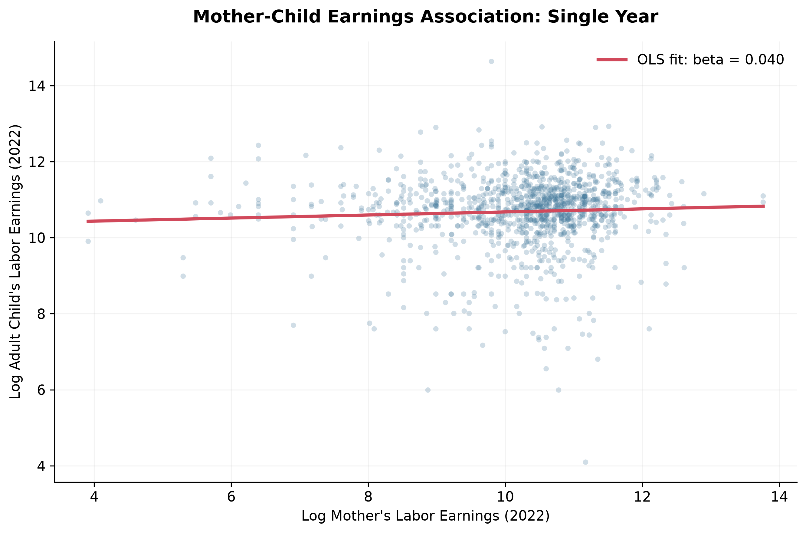
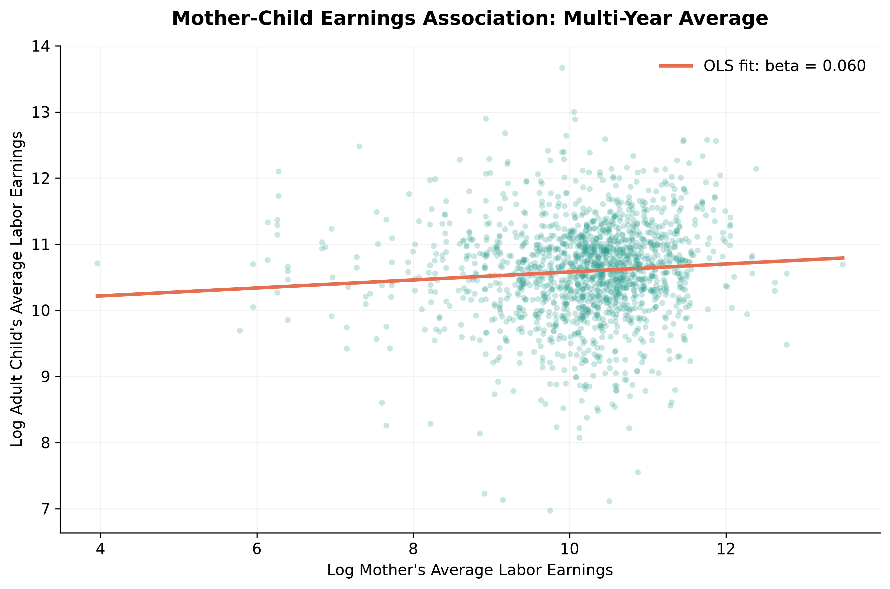
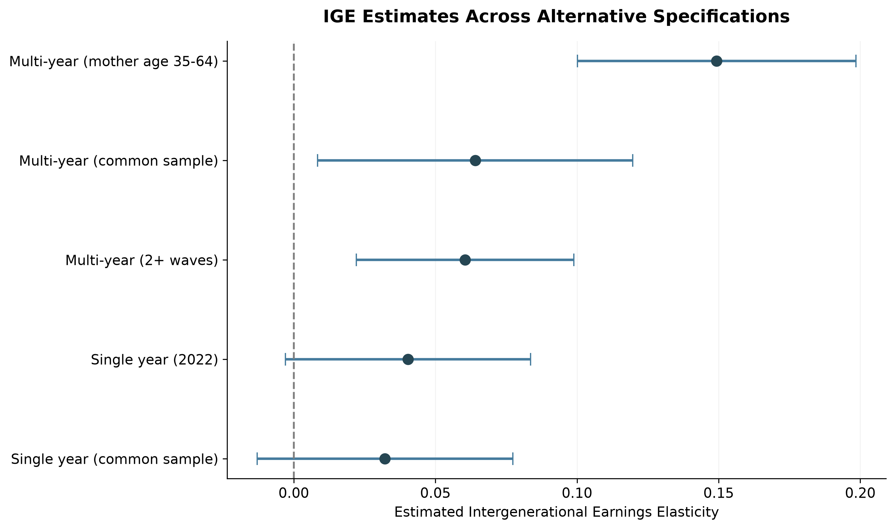
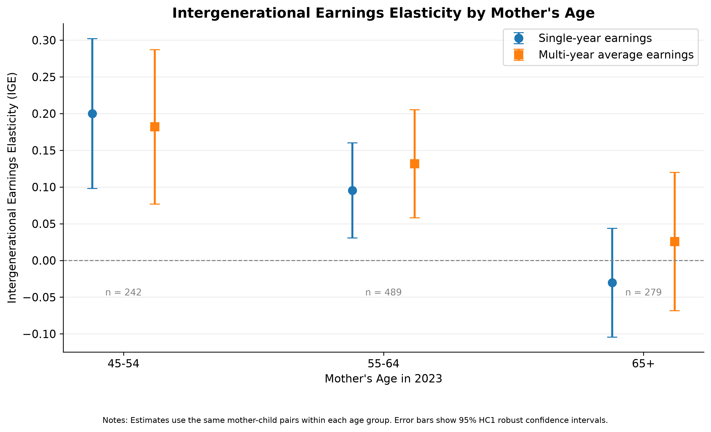
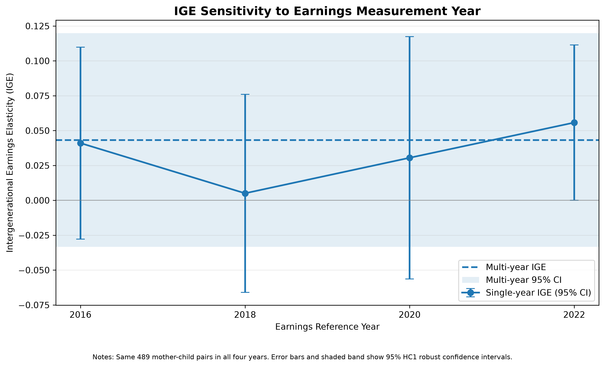

## Introduction: Why Match Generations?

Do children from higher-earning families tend to earn more as adults? Answering this question requires two tasks: identifying parents and children in longitudinal records, and measuring earnings in a way that reflects long-run economic status. A single year can be unusually good or bad, and earnings change as people enter the labor market or retire.

**Research question:** How can SQL inside Python match mothers and adult children in the Panel Study of Income Dynamics (PSID), and how sensitive is the estimated intergenerational earnings elasticity (IGE) to using one year versus several years of earnings?

This tutorial moves from identifiers to SQL joins, constructs individual earnings, uses SQL aggregation to average earnings, estimates the IGE, and examines measurement-year and maternal-age sensitivity.

The analysis concerns **birth mothers' and adult children's individual labor earnings**, not total parental household income or causal effects.

## 1. Data and Identifiers

The PSID follows people and families over time. We combine an individual file, a parent-identification file, and family interview earnings records.

The family interview identifiers change across survey waves, while stable individual identifiers allow us to follow the same people.

| Identifier | Meaning | Why it matters |
|---|---|---|
| `ER30001`, `ER30002` | Stable individual identifiers | Identify a person across records |
| `PID2`, `PID3` | Individual identifiers in the parent-identification file | Identify the child |
| `PID4`, `PID5` | Birth-mother identifiers | Identify the mother |
| Year-specific family interview ID | Family membership in a particular survey | Link the person-year to family earnings |

The surveys are biennial; the income reference year precedes the interview year.

| Interview year | Income year | Reference-person labor earnings | Spouse labor earnings |
|---|---|---|---|
| 2017 | 2016 | `ER71293` | `ER71321` |
| 2019 | 2018 | `ER77315` | `ER77343` |
| 2021 | 2020 | `ER81642` | `ER81670` |
| 2023 | 2022 | `ER85496` | `ER85524` |

We first assign reference-person or spouse labor earnings to the corresponding individual using the person's role within the family.

We **do not** assign total family earnings to every household member.

The full import and cleaning operations are implemented in `code/01_load_data.py` and `code/02_clean_data.py`.

## 2. SQL Inside Python: Match Birth Mothers and Children

Python's built-in `sqlite3` package runs SQL without requiring a separate database server.

The following teaching example illustrates the key operations. It assumes that the earlier cleaning steps produced DataFrames `pid_df` and `individual_df` with the original PSID identifier columns.

The complete executable pipeline is in `code/03_sql_matching.py`.

```{python}
#| eval: false

import sqlite3
import pandas as pd

with sqlite3.connect(":memory:") as conn:

    pid_df.to_sql(
        "pid",
        conn,
        index=False,
        if_exists="replace"
    )

    individual_df.to_sql(
        "individuals",
        conn,
        index=False,
        if_exists="replace"
    )

    pairs = pd.read_sql_query(
        """
        SELECT DISTINCT
            p.PID2 AS child_interview_id,
            p.PID3 AS child_person_number,
            p.PID4 AS mother_interview_id,
            p.PID5 AS mother_person_number

        FROM pid AS p

        INNER JOIN individuals AS c
            ON p.PID2 = c.ER30001
           AND p.PID3 = c.ER30002

        INNER JOIN individuals AS m
            ON p.PID4 = m.ER30001
           AND p.PID5 = m.ER30002

        WHERE p.PID4 IS NOT NULL
          AND p.PID5 IS NOT NULL
        """,
        conn
    )
```

### Understanding SELECT and JOIN

`SELECT` chooses the variables needed for the analysis, while `AS` assigns readable names.

The first `INNER JOIN` checks whether the child appears in the individual records.

The second `INNER JOIN` checks whether the birth mother also appears.

Each join uses **both components of the individual identifier**. Matching on only one component could incorrectly link unrelated individuals.

`WHERE` excludes records without usable maternal identifiers, and `DISTINCT` removes duplicate output rows.

An `INNER JOIN` retains only successful matches.

A `LEFT JOIN`, in contrast, preserves unmatched rows from the left-hand table.

### Why not match on family ID alone?

A child and mother may live in different households as the child grows up.

Their current family IDs therefore need not match, and family IDs are not stable individual identifiers.

The matching pipeline identifies **41,839 unique mother–child identifier pairs**.

After restricting to adult children aged 25 or older and pairs with age information for both generations in 2023, the working sample contains **4,242 pairs**.

These are candidate relationships, not yet the regression sample. Earnings requirements further reduce the number of observations.

## 3. Link Person-Years to Earnings

After identifying relatives, we connect each individual-year observation to the correct family interview record.

The join requires both the family ID and the interview year because a family interview identifier is not a permanent person identifier.

```{sql}
--| eval: false

SELECT
    i.interview_id,
    i.person_number,
    i.year,
    i.age,
    f.rp_income,
    f.spouse_income

FROM individual_long AS i

LEFT JOIN family_income_long AS f
    ON i.family_id = f.family_id
   AND i.year = f.year;
```

The query illustrates the join.

The executable script additionally uses relationship and sequence information to assign the correct **individual** earnings measure.

`LEFT JOIN` retains person-year observations even when the family earnings record is unavailable, making missingness visible rather than silently discarding observations.

The cleaned panel contains **96,340 person-year observations** across the four survey waves.

The implemented joins and validation checks are in `code/03_sql_matching.py`.

## 4. GROUP BY and Aggregation: Construct Multi-Year Earnings

A single observed earnings year may reflect a temporary shock.

We therefore construct a second earnings measure: each person's average observed positive labor earnings across the four income reference years.

```{python}
#| eval: false

# income_panel is the cleaned person-year earnings DataFrame.

with sqlite3.connect(":memory:") as conn:

    income_panel.to_sql(
        "income_panel",
        conn,
        index=False,
        if_exists="replace"
    )

    average_earnings = pd.read_sql_query(
        """
        SELECT
            interview_id,
            person_number,
            COUNT(*) AS n_positive_years,
            AVG(individual_income) AS avg_income,
            MIN(income_year) AS first_income_year,
            MAX(income_year) AS last_income_year

        FROM income_panel

        WHERE individual_income > 0

        GROUP BY
            interview_id,
            person_number
        """,
        conn
    )
```

### Understanding GROUP BY and Aggregation

`WHERE individual_income > 0` selects positive earnings observations before aggregation.

`GROUP BY` collects multiple year records belonging to the same individual.

`COUNT(*)` counts qualifying earnings observations, while `AVG()` calculates their arithmetic mean.

`MIN()` and `MAX()` identify the earliest and latest earnings years observed.

We require **at least two positive-income observations for both the mother and child** in the primary multi-year specification.

### Why Average Earnings?

Suppose an individual's observed earnings can be written as:

$$
Y_{it} = Y_i^{long-run} + u_{it}
$$

where $Y_i^{long-run}$ represents long-run earnings and $u_{it}$ represents a temporary income fluctuation.

Averaging over several years gives:

$$
\bar{Y}_i =
Y_i^{long-run}
+
\frac{1}{T}\sum_{t=1}^{T}u_{it}
$$

If temporary fluctuations partly offset one another, averaging can reduce their influence.

However, this study averages **positive observed nominal labor earnings**, not lifetime income.

Excluding zero-income years creates selection concerns, and the averages are not adjusted for inflation.

These limitations matter when interpreting the IGE.

## 5. Estimate the Intergenerational Earnings Elasticity

We estimate the following log–log OLS regression:

$$
\ln(Y_i^{child})
=
\alpha
+
\beta\ln(Y_i^{mother})
+
\varepsilon_i
$$

where:

- $Y_i^{child}$ is the adult child's labor earnings.
- $Y_i^{mother}$ is the birth mother's labor earnings.
- $\alpha$ is the intercept.
- $\beta$ is the intergenerational earnings elasticity.
- $\varepsilon_i$ represents other factors associated with child earnings.

The coefficient $\beta$ measures the percentage association between maternal and adult-child earnings.

For example, if $\beta = 0.10$, a 1% increase in maternal earnings is associated with approximately 0.10% higher child earnings.

A larger positive IGE indicates stronger measured earnings persistence across generations.

Importantly, this coefficient is **descriptive rather than causal**.

We report HC1 heteroskedasticity-robust standard errors and approximate 95% confidence intervals.

The regression analysis is implemented in `code/04_ige_analysis.py`.

### Single-Year Versus Multi-Year Results

| Specification | Mother–child pairs | IGE | 95% CI |
|---|---:|---:|---|
| Single-year (2022), available sample | 1,178 | 0.0403 | [−0.0030, 0.0836] |
| Multi-year (2+ positive waves), available sample | 1,602 | 0.0605 | [0.0221, 0.0988] |
| Single-year, common sample | 1,027 | 0.0322 | [−0.0129, 0.0773] |
| Multi-year, common sample | 1,027 | 0.0641 | [0.0085, 0.1197] |







### Interpretation

The first two specifications use different samples.

Therefore, their difference may reflect both income measurement and sample composition.

To address this concern, we compare the two measures using the **same 1,027 mother–child pairs**.

Within this common sample, the IGE increases from **0.0322** using single-year earnings to **0.0641** using multi-year average earnings.

This pattern is consistent with the possibility that temporary income fluctuations weaken measured intergenerational persistence.

However, a paired bootstrap with 1,000 replications estimates the difference as **0.0318**, with a 95% confidence interval of **[−0.0081, 0.0759]**.

Because the interval includes zero, we cannot conclude that averaging significantly increases the IGE.

The bootstrap also resamples mother–child pairs rather than clustering siblings or mothers, which is an additional inference limitation.

## 6. Life-Cycle Bias: Why Age at Measurement Matters

Labor earnings vary over the life cycle.

They may be relatively low early in a career, rise with experience, and decline when working hours decrease or retirement begins.

As a result, income observed at a particular age may not accurately represent an individual's long-run earning capacity.

This creates the possibility of **life-cycle bias** in estimated intergenerational earnings persistence.

For example, a mother who earned relatively high income during her working years may report low labor earnings after retirement.

If researchers observe only her retirement-year earnings, they may underestimate her earlier economic status.

### Comparing IGE Across Maternal Age Groups

We divide the sample into groups based on mothers' ages in 2023.

Within each age group, the single-year and multi-year estimates use the same mother–child pairs.

| Mother's age | Pairs | Single-year IGE | Multi-year IGE |
|---|---:|---:|---:|
| 45–54 | 242 | 0.2001 | 0.1819 |
| 55–64 | 489 | 0.0954 | 0.1317 |
| 65+ | 279 | −0.0304 | 0.0256 |



### Interpretation

The estimated IGE is substantially stronger among mothers aged 45–54 than among mothers aged 65 and older.

For the oldest group, the single-year estimate is slightly negative, while the multi-year estimate is close to zero.

Both confidence intervals include zero.

One possible explanation is that labor earnings measured near or after retirement provide a poor approximation of long-run economic status.

Averaging several years may reduce temporary fluctuations, but it may not fully correct retirement-related measurement problems.

However, these differences could also reflect cohort effects, employment selection, and other characteristics.

Moreover, bootstrap confidence intervals for the single-year versus multi-year differences include zero in every age group.

Therefore, the evidence is **consistent with potential life-cycle bias**, but it does not establish its magnitude or cause.

### Why life-cycle bias can arise

Life-cycle bias occurs when earnings measured at a particular age are an imperfect proxy for long-run economic status. Early-career earnings may understate future earning capacity, while earnings near or after retirement may understate earlier economic achievement. If these discrepancies differ systematically across mothers or children, a regression using current earnings can misrepresent the association between their longer-run earnings. Averaging observations across years can reduce transitory shocks, but it cannot fully correct systematic age-related differences or the exclusion of zero-earnings years.

**What the age-group results can and cannot show:** The weaker point estimates for older mothers are consistent with retirement-related measurement problems. However, age groups also differ in birth cohort, employment selection, and other characteristics; their estimates are not a causal test of life-cycle bias. The within-age-group bootstrap comparisons do not establish statistically significant differences between the two earnings measures.

## 7. Measurement-Year Sensitivity: A Fixed-Sample Demonstration

To examine the importance of measurement timing more directly, we hold the mother–child sample constant.

Using `code/06_lifecycle_analysis.py`, we identify **489 mother–child pairs** for whom both generations have positive labor earnings in all four observed income years:

2016, 2018, 2020, and 2022.

This balanced sample contains **1,956 pair-year observations**.

We then estimate a separate single-year IGE for each earnings year and compare these estimates with an IGE based on four-wave average earnings.

### Results

| Income year | Pairs | IGE | HC1 robust SE | 95% CI |
|---|---:|---:|---:|---|
| 2016 | 489 | 0.0410 | 0.0351 | [−0.0277, 0.1098] |
| 2018 | 489 | 0.0051 | 0.0362 | [−0.0660, 0.0761] |
| 2020 | 489 | 0.0305 | 0.0444 | [−0.0564, 0.1175] |
| 2022 | 489 | 0.0558 | 0.0284 | [0.0001, 0.1114] |
| **Four-wave average** | **489** | **0.0432** | **0.0391** | **[−0.0334, 0.1199]** |



### What Does Figure 5 Show?

The single-year IGE varies from **0.0051 in 2018** to **0.0558 in 2022**, even though the mother–child pairs remain exactly the same.

This demonstrates that the estimated relationship between maternal and child earnings is sensitive to the income measurement year.

A researcher observing only 2018 earnings would obtain a much smaller IGE point estimate than a researcher observing only 2022 earnings.

The multi-year IGE is **0.0432**, which lies within the range of the single-year estimates.

Importantly, multi-year averaging does not necessarily produce a larger IGE.

Its purpose is to reduce the influence of temporary earnings fluctuations, not to mechanically increase the estimated coefficient.

The confidence intervals indicate considerable statistical uncertainty.

The multi-year estimate's 95% confidence interval includes zero, and we have not conducted a formal paired test of all four yearly coefficients.

Therefore, the observed differences should not be interpreted as statistically significant without additional testing.

Furthermore, year-specific economic shocks may affect earnings alongside changes in age.

Figure 5 demonstrates **measurement-year sensitivity**, while Figure 4 provides complementary evidence about maternal age.

Together, they illustrate why single-point income measurement can create problems for studying intergenerational mobility, although they do not isolate a causal life-cycle effect.

## 8. Discussion: What Do These Results Tell Us?

Three findings are particularly important.

### First, Accurate Family Matching Is Essential

Intergenerational analysis begins with identifying the correct relatives.

Using stable individual identifiers and SQL joins prevents researchers from incorrectly matching individuals based only on current household membership.

SQL is therefore not simply a technical convenience. It determines which parent–child relationships enter the analysis.

### Second, Income Measurement Affects Estimated Mobility

Within the common sample of 1,027 mother–child pairs, the single-year IGE is 0.0322, compared with 0.0641 using multi-year earnings.

Although this difference is not statistically significant in the paired bootstrap, it demonstrates the importance of checking whether results depend on the chosen income measure.

The balanced-sample analysis reinforces this concern: single-year estimates vary across earnings years even when sample composition is held constant.

### Third, Averaging Is Useful but Not a Complete Solution

Multi-year averaging can reduce the influence of temporary income shocks.

However, it does not automatically remove life-cycle bias.

If observed earnings are concentrated near retirement, averaging several low-earnings years may still underestimate long-run earning capacity.

A longer income history measured during representative working ages would provide a better approximation of permanent economic status.

### Limitations

Several limitations should be considered.

1. **Maternal earnings only:** The analysis excludes paternal earnings and total parental household resources.
2. **Positive-income selection:** Zero-income observations are excluded from log-income regressions and positive-income averages.
3. **Limited observation window:** Four intermittent earnings years do not represent entire careers.
4. **Nominal earnings:** Multi-year averages are not inflation-adjusted.
5. **Survey representativeness:** PSID survey weights are not incorporated.
6. **Statistical dependence:** HC1 standard errors do not account for clustering among siblings or mothers.
7. **Noncausal interpretation:** The estimated IGE measures association, not the causal effect of maternal earnings on children's outcomes.

These limitations also help explain why the estimates should not be interpreted as nationally representative measures of intergenerational mobility.

## 9. Conclusion

This tutorial demonstrates how SQL within Python can be used to construct a longitudinal mother–child earnings dataset and estimate intergenerational earnings elasticity.

`SELECT` and `JOIN` identify relatives and connect records, while `GROUP BY`, `COUNT()`, and `AVG()` construct multi-year earnings measures.

Using PSID data, the IGE increases from **0.0322 to 0.0641** when moving from single-year to multi-year earnings within the same 1,027 mother–child pairs.

However, the paired-bootstrap difference is not statistically significant.

A stricter balanced sample of 489 pairs shows that single-year IGE estimates vary between **0.0051 and 0.0558** across four income years.

Age-group comparisons further suggest that the timing of income measurement may be particularly important when parental earnings are observed near retirement.

The broader lesson is that **intergenerational mobility estimates depend not only on the regression model but also on how individuals are matched and how economic status is measured**.

Careful SQL matching, transparent aggregation, consistent samples, and explicit treatment of measurement uncertainty are essential for credible longitudinal analysis.

## 10. Reproducibility and Code

The analysis is organized into six Python scripts:

| Script | Purpose |
|---|---|
| `01_load_data.py` | Import and inspect raw PSID data |
| `02_clean_data.py` | Clean identifiers and reshape individual records |
| `03_sql_matching.py` | Match mothers and children using SQL |
| `04_ige_analysis.py` | Construct earnings measures and estimate IGE |
| `05_visualizations.py` | Generate Figures 1–4 |
| `06_lifecycle_analysis.py` | Analyze measurement-year sensitivity and generate Figure 5 |

After obtaining the required PSID files, run the scripts from the project root:

```bash
conda run -n base python code/01_load_data.py
conda run -n base python code/02_clean_data.py
conda run -n base python code/03_sql_matching.py
conda run -n base python code/04_ige_analysis.py
conda run -n base python code/05_visualizations.py
conda run -n base python code/06_lifecycle_analysis.py
```

The shortened SQL snippets in this tutorial explain the essential operations.

The complete executable pipeline contains the data-loading steps, identifier validation, family-role assignment, regression procedures, and output generation.

See the accompanying `README.md` for the required packages, raw-data structure, and detailed reproduction instructions.

## References

- Panel Study of Income Dynamics (PSID), Survey Research Center, Institute for Social Research, University of Michigan. <https://psidonline.isr.umich.edu/>
- Solon, G. (1992). "Intergenerational Income Mobility in the United States." *American Economic Review*, 82(3), 393–408.
- Haider, S., & Solon, G. (2006). "Life-Cycle Variation in the Association between Current and Lifetime Earnings." *American Economic Review*, 96(4), 1308–1320.
